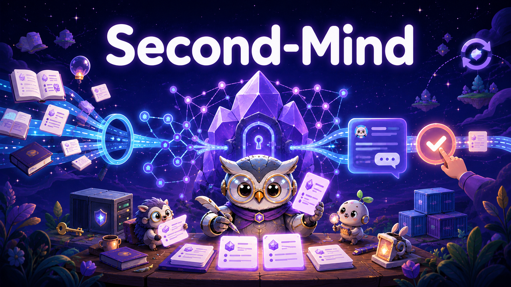
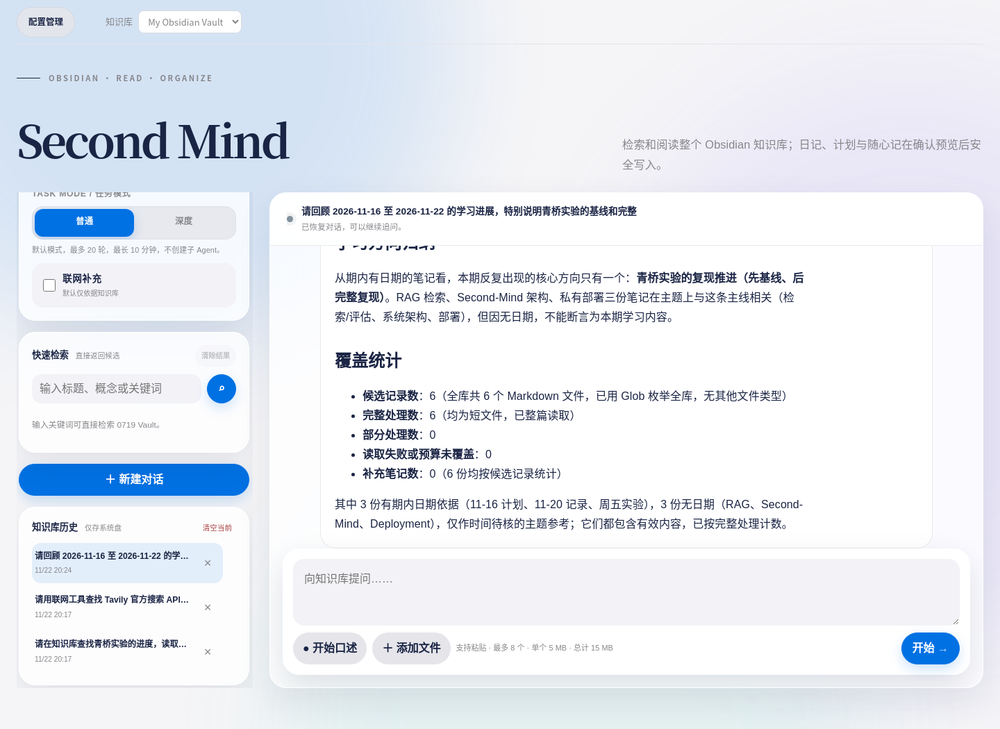
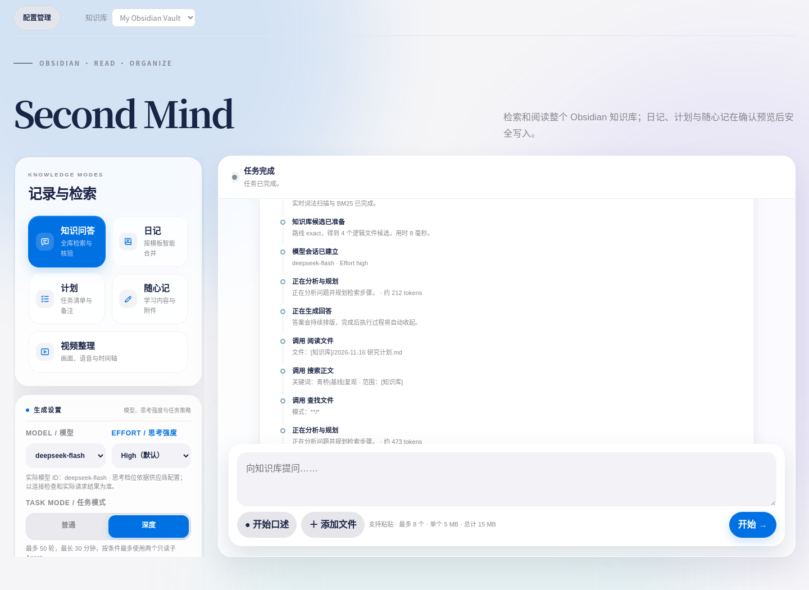
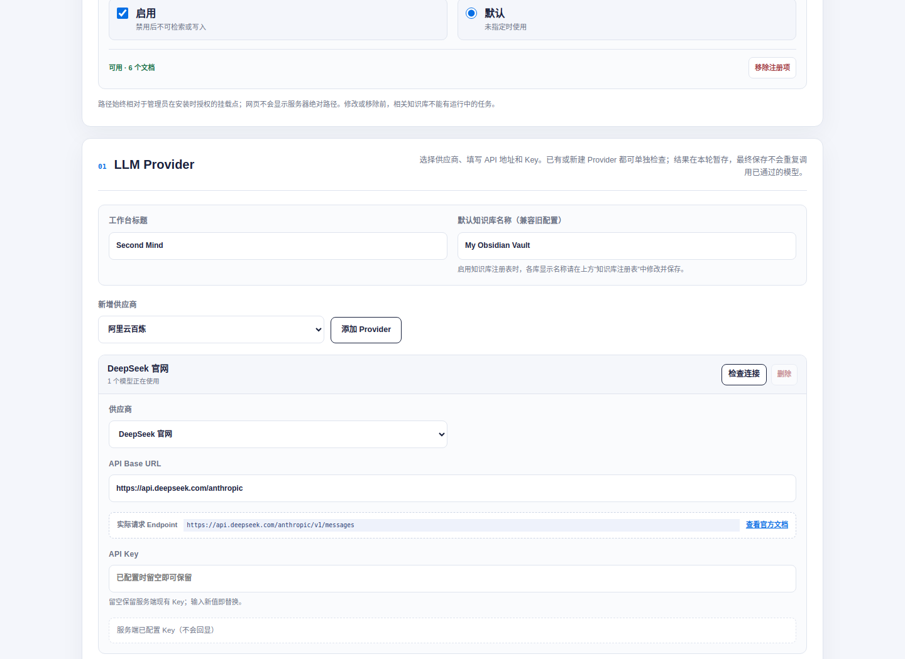
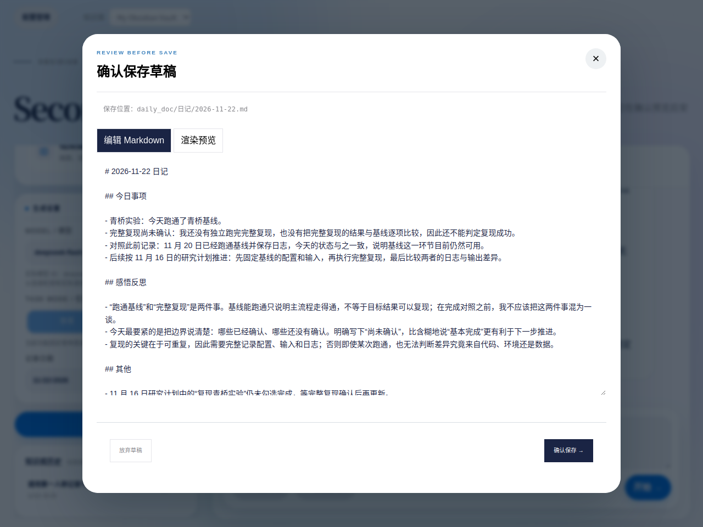
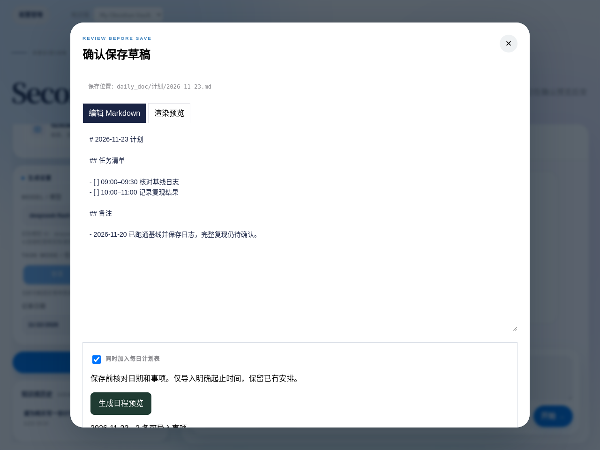
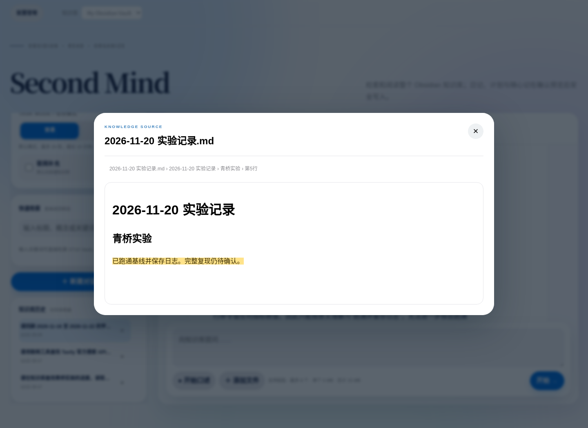
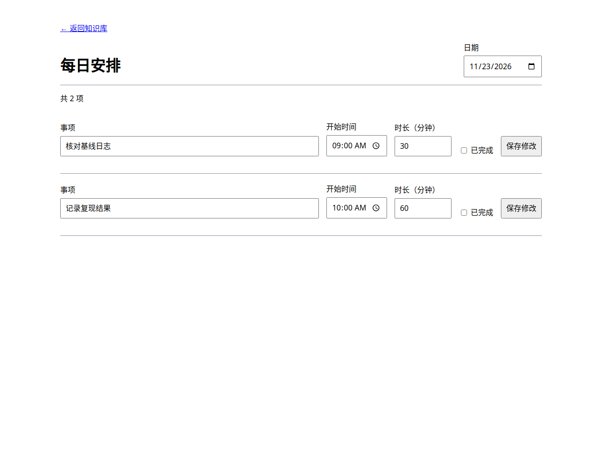
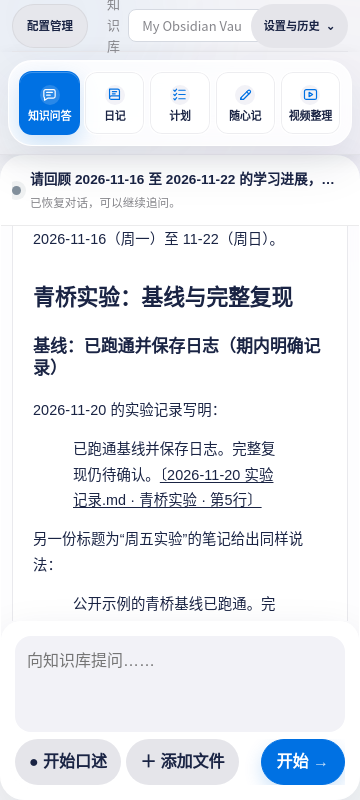

<p align="center">
  <a href="docs/assets/second-mind-hero.png"></a>
</p>

<p align="center"><strong>Ask your notes a question and follow the citations back to the source.</strong></p>

<p align="center">
  <a href="https://github.com/kygoyuan2004/Second-Mind/actions/workflows/ci.yml"></a>
  <a href="https://github.com/kygoyuan2004/Second-Mind/actions/workflows/pages.yml"></a>
  <a href="https://github.com/kygoyuan2004/Second-Mind/releases"></a>
  <a href="LICENSE"></a>
  <a href="package.json">=24.8.0" src="https://img.shields.io/badge/Node.js-22.22%2B%20%7C%2024.8%2B-417e38?style=flat-square"></a>
  <a href="docs/deployment.md"></a>
</p>

<p align="center">
  <a href="README.md">中文</a> |
  <a href="https://kygoyuan2004.github.io/Second-Mind/en/">Project site</a> |
  <a href="#quick-start">Quick start</a> |
  <a href="#features">Features</a> |
  <a href="#architecture-and-boundaries">Architecture</a> |
  <a href="#development-and-docs">Docs</a>
</p>

Second Mind is a self-hosted Obsidian workspace for one administrator. The Claude Agent SDK searches and reads notes in the selected Vault. Diaries, plans and scratch notes start as drafts and reach the Vault only after you confirm.



## Quick start

### Desktop app

Download the package for your system from [GitHub Releases](https://github.com/kygoyuan2004/Second-Mind/releases). On first launch, open a local Obsidian Vault or connect to an existing Second Mind server over HTTPS.

| System | Package |
| --- | --- |
| Windows x64 | `.exe` installer |
| Linux x86_64 | `.AppImage` or `.deb` for Debian / Ubuntu |

The desktop app includes Node.js, Python and FFmpeg. Local and remote workspaces keep separate data and sessions. On Linux, unlock the system keyring to save desktop credentials.

<a name="docker-web"></a>

### Self-host with Docker

Install Git and start Docker. Use Docker Engine with Compose v2 on Linux, or Docker Desktop with Linux containers on Windows and macOS.

#### Linux / macOS

```bash
git clone https://github.com/kygoyuan2004/Second-Mind.git
cd Second-Mind
./install.sh
```

#### Windows PowerShell

```powershell
git clone https://github.com/kygoyuan2004/Second-Mind.git
cd Second-Mind
powershell -ExecutionPolicy Bypass -File .\install.ps1
```

The installer asks for a Vault, port and administrator password. After signing in, you can run a local keyword search. To ask a model a question, add a connection in Settings. The Docker image includes Node.js. [Configuration guide](docs/configuration.md)

<details>
<summary>Platform guides and verification</summary>

[Windows 10/11](docs/quickstart-windows.md) · [macOS Intel / Apple Silicon](docs/quickstart-macos.md) · [Linux amd64 / arm64](docs/quickstart-linux.md) · [Docker deployment and backups](docs/deployment.md)

Local and remote Q&A were tested on Windows 11 x64. Windows 10 x64 desktop installation awaits verification. Linux desktop packages were checked on Ubuntu and Debian. Docker installation, upgrades, backups and restores were tested on Linux amd64. The full Docker Desktop lifecycle on Windows and macOS awaits verification. [Desktop and Docker results](docs/desktop-web-release.md) · [SDK migration matrix](docs/claude-sdk-migration.md)

</details>

## Features

- **Search and cite.** Use keyword, semantic or hybrid search. Open a result or an answer citation to jump to the matching passage in the original note.
- **Normal and deep Q&A.** Normal Q&A allows up to 20 turns in 10 minutes. Deep Q&A allows up to 50 turns in 30 minutes and can call up to two read-only subagents when needed. Reopen a conversation after a refresh or resume its SDK session after a restart.
- **Review a week of learning.** The agent lists notes for the requested dates before reading them. The review distinguishes completed work, work in progress and plans, and reports gaps in coverage.
- **Review before writing.** Diaries, plans, scratch notes and video notes start as **editable Markdown drafts**. Review the text and select plan items before confirming. The app saves the note and adds selected items to their scheduled dates. It checks for concurrent edits and keeps a recovery copy before replacing a note.
- **Read attachments.** Qwen 3.8 Max accepts images and PDFs. Audio and video can be transcribed locally. The app can also extract video frames for the model.
- **Switch Vaults.** Each knowledge base owns its indexes, sessions, tasks, drafts and citations. Saves go to the selected Vault.
- **Bring your own key (BYOK).** Manage connections, the default model, reasoning effort, web search and embedding indexes in Settings, where you can also name the workspace and register Vaults. Changing the model, effort or web setting starts a new conversation.

<a name="actual-application-screenshots"></a>

## Screenshots

These examples come from an isolated demo Vault. Open a thumbnail to inspect the tool calls from a real DeepSeek session or read a draft before it was saved.

<table>
  <tr>
    <td width="50%" valign="top">
      <strong>Tool execution</strong><br>
      <a href="docs/assets/second-mind-execution.png"></a><br>
      Follow the order in which notes were found and read.
    </td>
    <td width="50%" valign="top">
      <strong>Provider settings</strong><br>
      <a href="docs/assets/second-mind-provider-config.png"></a><br>
      Check the request endpoint and test each connection.
    </td>
  </tr>
  <tr>
    <td width="50%" valign="top">
      <strong>Diary draft</strong><br>
      <a href="docs/assets/second-mind-diary.png"></a><br>
      Review the date and entry before saving.
    </td>
    <td width="50%" valign="top">
      <strong>Plan draft</strong><br>
      <a href="docs/assets/second-mind-plan.png"></a><br>
      Review the plan and choose items for the daily schedule.
    </td>
  </tr>
</table>

<details>
<summary>More views · Source passages · Daily schedule · Mobile layout</summary>

<table>
  <tr>
    <td width="50%" valign="top">
      <strong>Source passage</strong><br>
      <a href="docs/assets/second-mind-source.png"></a><br>
      Open a citation to see the supporting passage highlighted.
    </td>
    <td width="50%" valign="top">
      <strong>Daily schedule</strong><br>
      <a href="docs/assets/second-mind-schedule.png"></a><br>
      Adjust the start time and duration of each confirmed item.
    </td>
  </tr>
</table>

<p align="center">
  <a href="docs/assets/second-mind-mobile.png"></a>
</p>
<p align="center">Mobile view · Read a review and ask a follow-up in one column.</p>

</details>

## Architecture and boundaries

Local desktop mode and Docker Web share the same backend. When you connect to a remote workspace, its server handles retrieval, sessions and drafts for the selected Vault.

[](docs/assets/second-mind-workflow.svg)

### Runtime and privacy

- **Runtime.** The app pins `@anthropic-ai/claude-agent-sdk@0.3.247`. Generation requires Anthropic Messages. Migrate older OpenAI Chat Completions connections in Settings. [Configuration guide](docs/configuration.md)
- **Verified providers.** Bailian, DeepSeek, Kimi and a custom connection each returned two consecutive answers through the SDK on demo notes. The custom test used DeepSeek’s official Messages endpoint. Check other compatible endpoints individually. [Release verification](docs/desktop-web-release.md)

> [!IMPORTANT]
> **Credentials and state.** Each task keeps its model connection. The server attaches the real key only to HTTPS requests to that endpoint. The browser can read whether a key is configured. The SDK subprocess receives a temporary local token and uses private per-Vault state outside the Vault. Host `~/.claude` settings are never loaded.
>
> **Data sent to services.** External models receive questions, conversation context, submitted attachments and passages returned by tools. Building a remote embedding index can send every eligible chunk in the selected Vault. When enabled, web search may send queries and URLs to the search service. Personal learning reviews skip web search. [Data flow](docs/data-flow.md) · [Security boundaries](docs/security.md)

<details>
<summary>Upgrading from Pi</summary>

The [v0.2.1 source archive](https://github.com/kygoyuan2004/Second-Mind/tree/v0.2.1/archive/pi) preserves the previous Pi executor, tests and documentation. Upgrades keep original conversations, drafts and state files. The SDK creates its new state in a separate directory. [Migration notes](docs/claude-sdk-migration.md)

</details>

<a name="development"></a>

## Development and docs

Source development requires Node.js `^22.22.0 || >=24.8.0`. Use Docker to check the audio and video runtime.

```bash
npm ci
npm run check
npm test
npm run site:check
```

| Document | What it covers |
| --- | --- |
| [Architecture and source map](docs/architecture.md) | Trace the HTTP / SSE service to the SDK, retrieval tools, state storage and write logic. |
| [Configuration](docs/configuration.md) | Connect a model, check credentials, enable web search and build or activate a Vault’s semantic index. |
| [HTTP / SSE API](docs/api.md) | Authentication, streaming task events, draft confirmation and error responses. |
| [Learning reviews](docs/learning-review.md) | How the agent fixes a date range, finds evidence and reports coverage. |
| [SDK migration and validation](docs/claude-sdk-migration.md) | Changes from the previous runtime, tested platforms and known limits. |
| [Deployment and rollback](docs/deployment.md) | Install and update Docker instances, back up the Vault and state, and restore them separately. |
| [Vault synchronization](docs/sync.md) | Set up an independent sync process or Obsidian Headless, handle write conflicts and manage backups. |

---

Second Mind serves one trusted administrator. Note reads and writes stay within the selected Vault.

[Contributing](CONTRIBUTING.md) · [Report a security issue](SECURITY.md) · [Changelog](CHANGELOG.md) · [MIT License](LICENSE)
