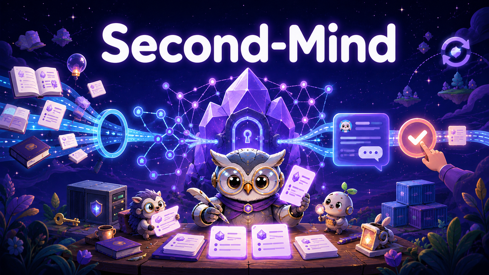
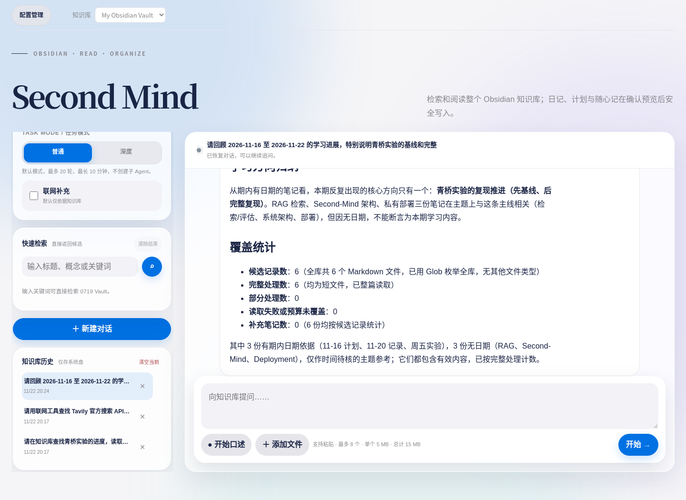
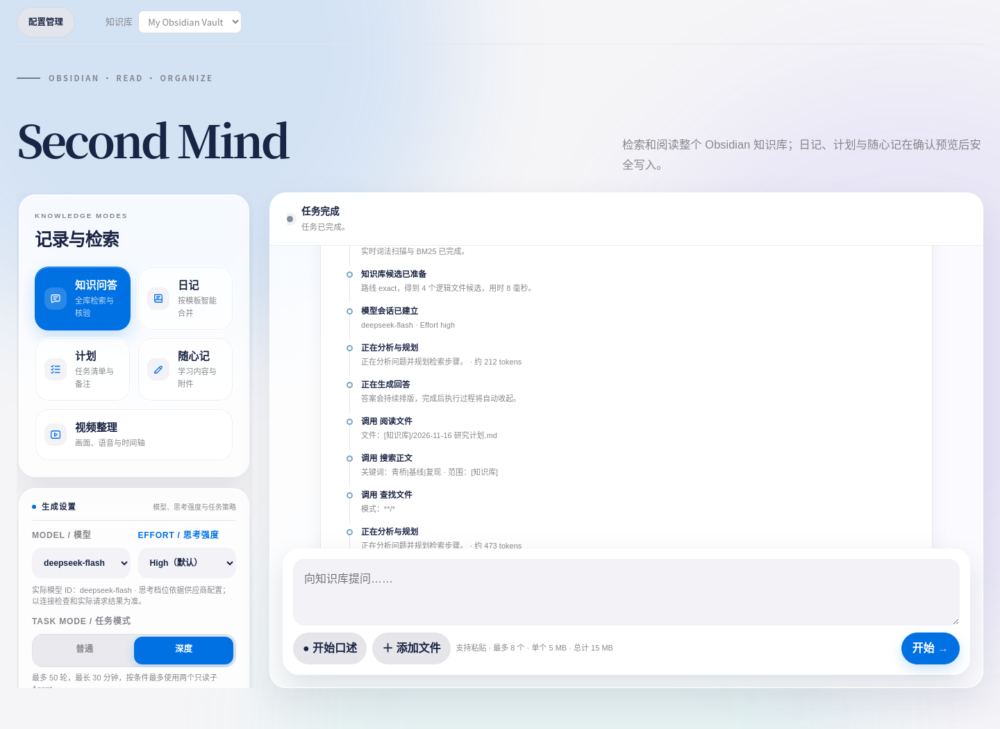
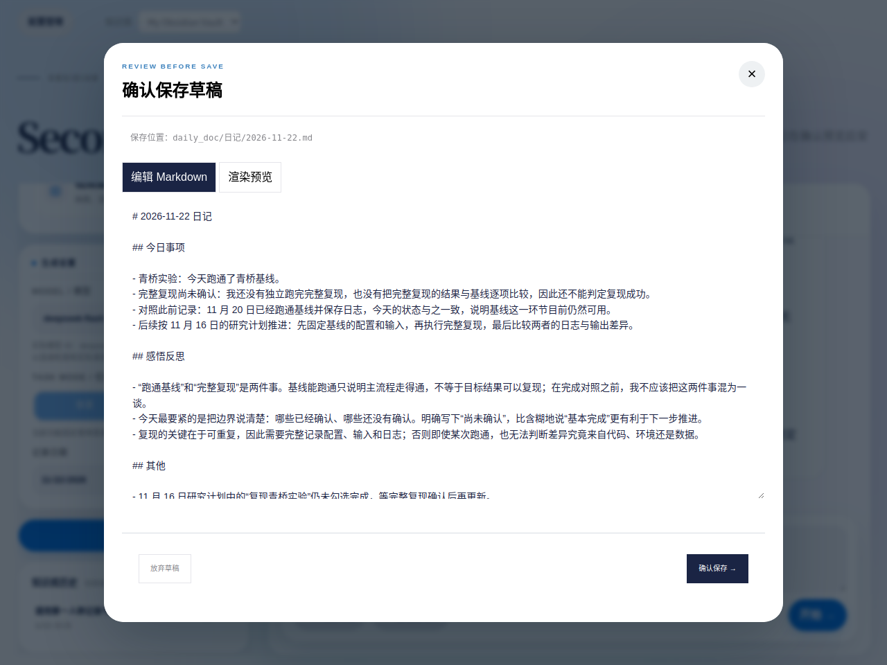
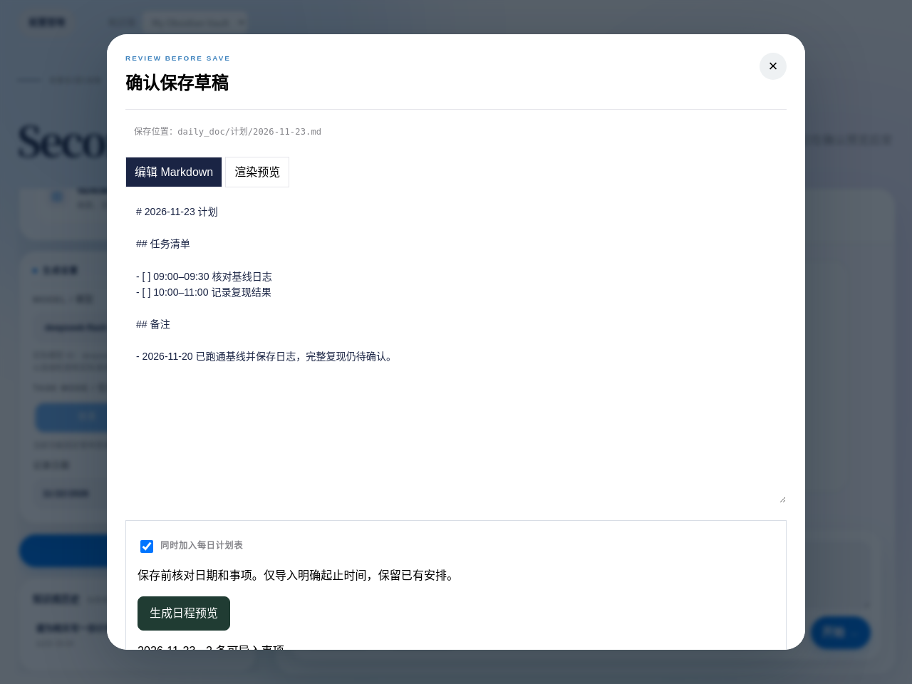

<p align="center">
  <a href="docs/assets/second-mind-hero.png">
    
  </a>
</p>

<h1 align="center">Second Mind</h1>

<p align="center"><strong>用自己的 Obsidian 笔记回顾一周：核对原文，区分计划与进展，再把选中的事项加入每日安排。</strong></p>

<p align="center">
  <a href="README.en.md">English</a> ·
  <a href="https://kygoyuan2004.github.io/Second-Mind/">项目展示</a> ·
  <a href="#桌面软件下载">安装</a> ·
  <a href="docs/configuration.md">配置</a> ·
  <a href="docs/claude-sdk-migration.md">迁移与验收</a>
</p>

<p align="center">
  <a href="https://github.com/kygoyuan2004/Second-Mind/actions/workflows/ci.yml">
    
  </a>
  <a href="https://github.com/kygoyuan2004/Second-Mind/actions/workflows/pages.yml">
    
  </a>
</p>



Second Mind 是单管理员、自托管知识工作台。Claude Agent SDK 负责真实的检索、读取、工具循环和多轮会话；日记、计划、随心记与视频笔记先生成草稿，编辑并确认后才写入 Vault。

## 桌面软件下载

Windows x64 安装包、Linux x86_64 AppImage 和 Debian/Ubuntu 安装包都支持本机知识库和远程服务器连接。桌面版自带 Node、Python 和 FFmpeg。Linux 桌面使用系统密钥环。打开本地 Vault 和连接远程服务器各自使用独立的数据与会话。[GitHub Releases](https://github.com/kygoyuan2004/Second-Mind/releases) · [平台验收记录](docs/desktop-web-release.md)

## Docker 网页版


准备 Git 和 Docker。Linux 使用 Docker Engine 与 Compose v2；Windows、macOS 使用 Docker Desktop 的 Linux 容器。

```bash
git clone https://github.com/kygoyuan2004/Second-Mind.git
cd Second-Mind
./install.sh
```

Windows PowerShell：

```powershell
git clone https://github.com/kygoyuan2004/Second-Mind.git
cd Second-Mind
powershell -ExecutionPolicy Bypass -File .\install.ps1
```

安装器配置 Vault 目录、端口和管理员密码。宿主机不需要 Node.js。首次启动后，在配置管理中添加模型连接；未配置模型时仍可登录和进行本地关键词检索。

[Windows 10/11](docs/quickstart-windows.md) · [macOS Intel / Apple Silicon](docs/quickstart-macos.md) · [Linux amd64 / arm64](docs/quickstart-linux.md) · [Docker 与备份](docs/deployment.md)

支持矩阵与实测范围见[验收记录](docs/claude-sdk-migration.md)。支持声明与平台实测结果分别记录。

## 可以做什么

| 场景 | 实际行为 |
| --- | --- |
| 问答与来源 | 关键词、语义或混合检索，按需读取原文，点击引用预览笔记 |
| 普通 / 深度 | 普通最多 20 轮、10 分钟；深度最多 50 轮、30 分钟，按条件使用最多两个只读子 Agent |
| 学习回顾 | 固定日期范围，先枚举再读原文，区分计划、进行中和已完成，报告覆盖缺口 |
| 日记 / 计划 / 随心记 | 生成 Markdown，预览和编辑后确认保存；并发修改检查及覆盖前恢复副本 |
| 图片 / PDF / 音视频 | Qwen 3.8 Max 支持图片和 PDF；语音转写、视频关键帧和转写在容器中处理 |
| 多知识库 | 独立索引、会话、任务、草稿、引用与写入；从页面切换 |
| 配置管理 | 模型、默认模型、原生思考等级、联网、Embedding、索引构建、名称和知识库注册 |
| 会话 | 刷新后从历史列表重新打开；重启可续接 SDK 会话；模型、思考等级或联网设置变化时新建对话 |

## 实际使用截图

以下截图来自隔离演示库与真实 DeepSeek SDK 任务。学习回顾区分已跑通的基线与待确认的完整复现，计划经过预览和确认后写入两项日程。

| 执行过程 | 配置管理 |
| --- | --- |
|  |  |

| 日记草稿 | 计划草稿 |
| --- | --- |
|  |  |

[查看定位到原文段落的效果](docs/assets/second-mind-source.png) · [查看确认后的每日安排](docs/assets/second-mind-schedule.png)

## 模型与数据边界

固定使用 `@anthropic-ai/claude-agent-sdk@0.3.247`。百炼、DeepSeek、Kimi 和自定义连接均已在独立演示库完成两轮真实 SDK 问答。自定义连接使用 DeepSeek 的官方 Messages 接口。模型 ID 按输入原样发送。[本版验收记录](docs/desktop-web-release.md)

服务端按任务固定连接和凭据。真实 Key 不交给浏览器或 SDK 子进程；SDK 使用独立私有状态目录，不读取宿主机的 `~/.claude`。模型仍会收到问题、附件和工具返回的笔记片段，远程 Embedding 会收到索引文本；自托管不等于模型处理全部留在本机。[数据流](docs/data-flow.md) · [安全边界](docs/security.md)

[v0.2.1 源码归档](https://github.com/kygoyuan2004/Second-Mind/tree/v0.2.1/archive/pi)保留了旧 Pi 执行器、文档和测试。升级保留旧会话、草稿和原始状态，新 SDK 状态使用独立目录。

## 开发与文档

本地源码运行需要 Node.js 22.22+（或 24.8+），音视频建议通过 Docker 验证。

```bash
npm ci
npm run check
npm test
npm run site:check
```

- [架构与源码映射](docs/architecture.md)
- [配置与保存生效规则](docs/configuration.md)
- [HTTP / SSE 接口](docs/api.md)
- [学习回顾](docs/learning-review.md)
- [迁移差异、验证范围与限制](docs/claude-sdk-migration.md)
- [部署与回滚](docs/deployment.md)
- [同步方式](docs/sync.md)

MIT License。当前面向一个可信管理员，不提供多租户权限或跨库联合检索。
