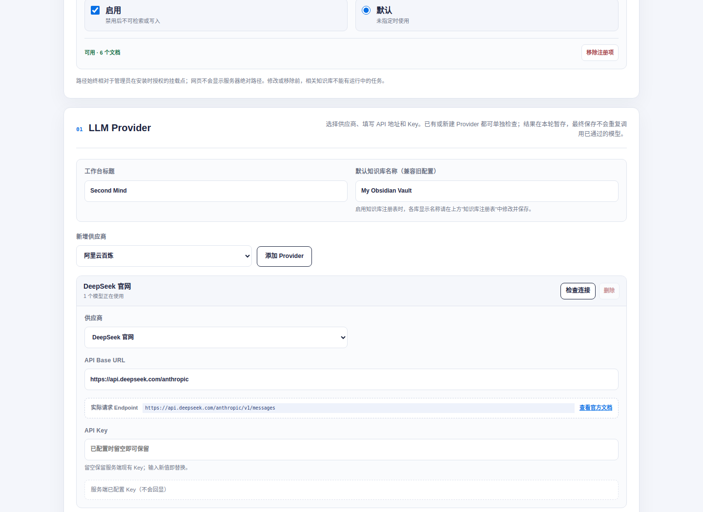
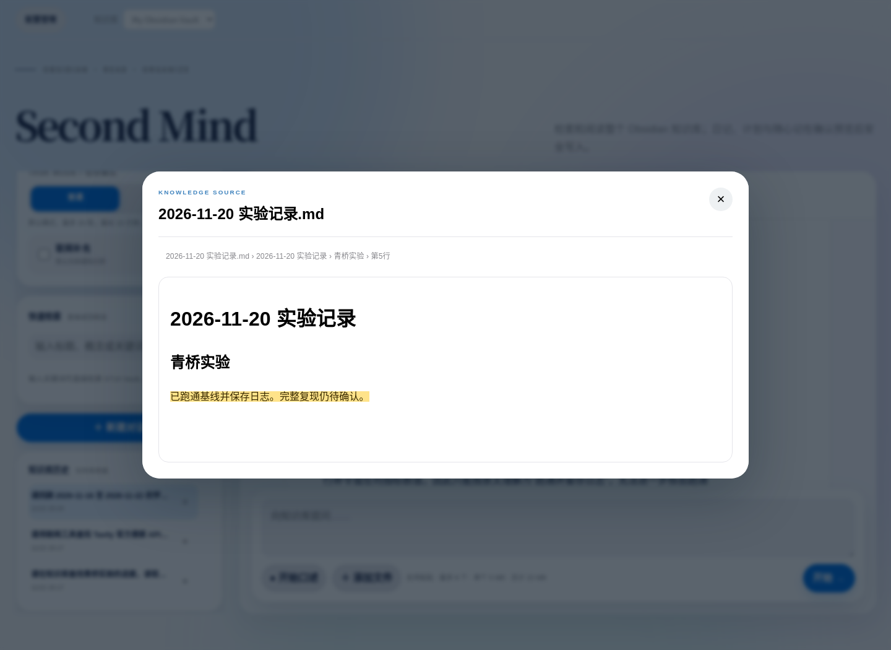
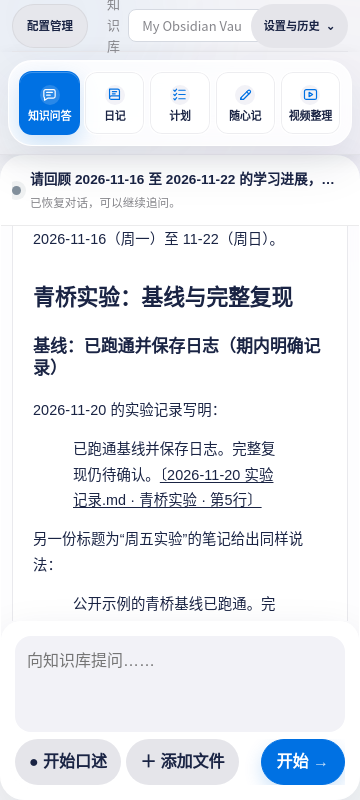

<p align="center">
  <a href="docs/assets/second-mind-hero.png"></a>
</p>

<p align="center"><strong>在自己的笔记里提问，沿着引文核对原文。</strong></p>

<p align="center">
  <a href="https://github.com/kygoyuan2004/Second-Mind/actions/workflows/ci.yml"></a>
  <a href="https://github.com/kygoyuan2004/Second-Mind/actions/workflows/pages.yml"></a>
  <a href="https://github.com/kygoyuan2004/Second-Mind/releases"></a>
  <a href="LICENSE"></a>
  <a href="package.json">=24.8.0" src="https://img.shields.io/badge/Node.js-22.22%2B%20%7C%2024.8%2B-417e38?style=flat-square"></a>
  <a href="docs/deployment.md"></a>
</p>

<p align="center">
  <a href="README.en.md">English</a> |
  <a href="https://kygoyuan2004.github.io/Second-Mind/">项目展示</a> |
  <a href="#快速开始">快速开始</a> |
  <a href="#核心能力">核心能力</a> |
  <a href="#架构与边界">架构与边界</a> |
  <a href="#开发与文档">文档</a>
</p>

Second Mind 是面向单管理员的自托管 Obsidian 工作台。Claude Agent SDK 在所选知识库中检索和读取笔记。日记、计划和随心记先生成草稿，经你确认后才写回 Vault。


## 快速开始

### 方式一：桌面客户端（开箱即用）

从 [GitHub Releases](https://github.com/kygoyuan2004/Second-Mind/releases) 下载对应的安装包。首次打开时，选择本机 Obsidian Vault，或连接已有的 Second Mind HTTPS 服务器。

| 系统 | 下载文件 |
| --- | --- |
| Windows x64 | `.exe` 安装程序 |
| Linux x86_64 | `.AppImage`，或适用于 Debian / Ubuntu 的 `.deb` 包 |

桌面版自带 Node.js、Python 和 FFmpeg。本机与远程工作区各自保存数据和会话。Linux 保存桌面凭据需要已解锁的系统密钥环。

<a name="docker-网页版"></a>

### 方式二：Docker 网页版（自托管部署）

先安装 Git 并启动 Docker。Linux 使用 Docker Engine 和 Compose v2，Windows 和 macOS 使用 Docker Desktop 的 Linux 容器。

#### Linux / macOS

```bash
git clone https://github.com/kygoyuan2004/Second-Mind.git
cd Second-Mind
./install.sh
```

#### Windows PowerShell

```powershell
git clone https://github.com/kygoyuan2004/Second-Mind.git
cd Second-Mind
powershell -ExecutionPolicy Bypass -File .\install.ps1
```

按提示选择 Vault、端口和管理员密码。登录后即可进行本地关键词检索。要开始问答，在「配置管理」中添加模型连接。Docker 部署所需的 Node.js 已包含在镜像中。[配置指南](docs/configuration.md)

<details>
<summary>各平台安装指南与实测范围</summary>

[Windows 10/11](docs/quickstart-windows.md) · [macOS Intel / Apple Silicon](docs/quickstart-macos.md) · [Linux amd64 / arm64](docs/quickstart-linux.md) · [Docker 部署与备份](docs/deployment.md)

Windows 11 x64 已实测本地与远程问答，Windows 10 x64 桌面安装待实测。Linux 桌面包已在 Ubuntu 和 Debian 环境中分别验收。Docker 安装、升级、备份与恢复已在 Linux amd64 实测，Windows 与 macOS 上的 Docker Desktop 完整安装和升级流程待实测。[桌面与 Docker 验收记录](docs/desktop-web-release.md) · [SDK 迁移验收矩阵](docs/claude-sdk-migration.md)

</details>

<a name="可以做什么"></a>

## 核心能力

- **检索与原文定位**　用关键词、语义或混合检索找到笔记，点击搜索结果或回答引用即可定位到原文段落。
- **普通与深度问答**　普通问答最多 20 轮、10 分钟。深度问答最多 50 轮、30 分钟，必要时可调用最多两个只读子 Agent。刷新后可从历史记录重开对话，重启后可续接 SDK 会话。
- **回顾学习**　按指定日期先列出候选笔记，再读原文。回顾区分已完成、进行中和计划，并说明哪些材料尚未覆盖。
- **草稿确认写入**　日记、计划、随心记和视频笔记先生成 **Markdown 草稿**。可编辑正文、勾选计划事项，确认后才写入 Vault 并将选中事项加入对应日期的安排。保存时检查并发修改，覆盖已有笔记前保留恢复副本。
- **多模态附件**　Qwen 3.8 Max 支持图片和 PDF。音视频可在本地转写，视频还可提取关键帧供模型分析。
- **多知识库**　每个 Vault 独立保存索引、会话、任务、草稿和引用，写入目标随当前知识库切换。
- **自带密钥（BYOK）**　在配置页管理连接、默认模型、思考等级、联网搜索和 Embedding 索引，也可修改工作台名称、注册知识库。更换模型、思考等级或联网设置时，界面会开启新对话。

## 实际使用截图

以下界面来自独立演示库。点击缩略图可查看原图，核对真实 DeepSeek 问答的工具记录，或查看草稿保存前的内容。

<table>
  <tr>
    <td width="50%" valign="top">
      <strong>执行过程</strong><br>
      <a href="docs/assets/second-mind-execution.png"></a><br>
      展开问答记录，查看搜索和读取笔记的顺序。
    </td>
    <td width="50%" valign="top">
      <strong>配置管理</strong><br>
      <a href="docs/assets/second-mind-provider-config.png"></a><br>
      核对实际请求地址，逐个检查模型连接。
    </td>
  </tr>
  <tr>
    <td width="50%" valign="top">
      <strong>日记草稿</strong><br>
      <a href="docs/assets/second-mind-diary.png"></a><br>
      核对日期和正文，再决定是否保存。
    </td>
    <td width="50%" valign="top">
      <strong>计划草稿</strong><br>
      <a href="docs/assets/second-mind-plan.png"></a><br>
      检查计划正文，选择要加入每日安排的事项。
    </td>
  </tr>
</table>

<details>
<summary>展开查看更多界面 · 原文段落定位 · 每日安排 · 移动端适配</summary>

<table>
  <tr>
    <td width="50%" valign="top">
      <strong>原文段落定位</strong><br>
      <a href="docs/assets/second-mind-source.png"></a><br>
      点开回答引用，直接核对高亮的证据段落。
    </td>
    <td width="50%" valign="top">
      <strong>每日安排</strong><br>
      <a href="docs/assets/second-mind-schedule.png"></a><br>
      两项已确认的计划可分别调整开始时间和时长。
    </td>
  </tr>
</table>

<p align="center">
  <a href="docs/assets/second-mind-mobile.png"></a>
</p>
<p align="center">移动端 · 在单栏视图中阅读回顾并继续追问。</p>

</details>

## 架构与边界

桌面本机模式与 Docker 网页版共用同一套后端。连接远程工作区时，所选 Vault 的检索、会话和草稿均由远程服务处理。

[](docs/assets/second-mind-workflow.svg)

### 模型与数据边界

- **运行时**　固定使用 `@anthropic-ai/claude-agent-sdk@0.3.247`。生成模型须支持 Anthropic Messages。旧 OpenAI Chat Completions 配置可在管理页迁移。[配置指南](docs/configuration.md)
- **实测连接**　百炼、DeepSeek、Kimi 及自定义连接均已在演示库完成连续两轮真实 SDK 问答。自定义项测试的是 DeepSeek 官方 Messages 端点，其他兼容端点需单独检查。[验收记录](docs/desktop-web-release.md)

> [!IMPORTANT]
> **凭据与状态**　服务端为每个任务固定模型连接，只在发往已配置端点的 HTTPS 请求上附加真实 Key。浏览器读取配置时只看到密钥是否已设置，SDK 子进程只拿到临时本地令牌。每个库的 SDK 状态保存在 Vault 外的私有目录，宿主机的 `~/.claude` 配置不会被加载。
>
> **数据出站**　外部模型会收到问题、会话上下文、提交的附件和工具读到的笔记片段。构建远程 Embedding 索引可能发送所选库中所有符合索引条件的笔记片段。启用联网搜索后，查询词和待提取的网址可能发往搜索服务。个人学习回顾跳过联网搜索。[数据流](docs/data-flow.md) · [安全边界](docs/security.md)

<details>
<summary>从旧版 Pi 升级</summary>

旧 Pi 执行器、测试和文档保存在 [v0.2.1 源码归档](https://github.com/kygoyuan2004/Second-Mind/tree/v0.2.1/archive/pi)。升级保留原会话、草稿和状态文件，SDK 在独立目录中建立新状态。[迁移说明](docs/claude-sdk-migration.md)

</details>

## 开发与文档

从源码开发时，Node.js 版本需满足 `^22.22.0 || >=24.8.0`。可使用 Docker 验证音视频所需的运行环境。

```bash
npm ci
npm run check
npm test
npm run site:check
```

| 文档 | 内容简介 |
| --- | --- |
| [架构与源码](docs/architecture.md) | 从 HTTP / SSE 服务找到 SDK、检索工具、状态存储和写入逻辑的实现。 |
| [配置指南](docs/configuration.md) | 连接模型、检查凭据、启用联网搜索，以及为选中的库构建和激活语义索引。 |
| [HTTP / SSE 接口](docs/api.md) | 查阅认证要求、任务事件流、草稿确认和错误响应。 |
| [学习回顾](docs/learning-review.md) | 了解日期范围如何确定、哪些笔记能作为证据，以及如何解读覆盖情况。 |
| [SDK 迁移与验收](docs/claude-sdk-migration.md) | 对照旧版行为、迁移后的差异、平台验证结果与限制。 |
| [部署与回滚](docs/deployment.md) | 安装和更新 Docker 实例，备份状态与 Vault，并在独立目录中恢复。 |
| [知识库同步](docs/sync.md) | 配置独立同步进程或 Obsidian Headless，处理写入冲突和备份。 |

---

Second Mind 面向一位可信管理员，笔记的读取和写入都限定在当前选中的知识库内。

[贡献指南](CONTRIBUTING.md) · [安全问题反馈](SECURITY.md) · [更新日志](CHANGELOG.md) · [MIT License](LICENSE)
